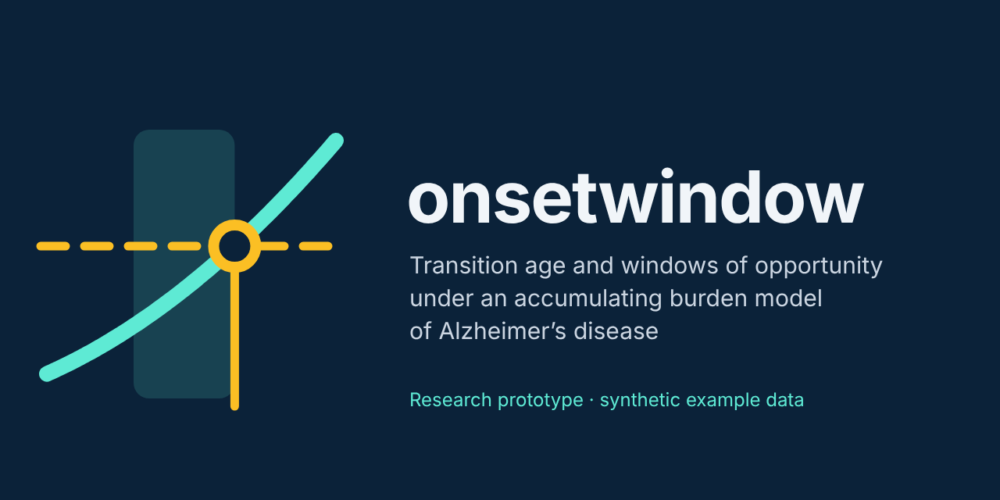

# Riskclock: Individual Risk Trajectories for Alzheimer’s Disease as an Accumulating, Whole-Body Process

<p align="center">
  
</p>

Individual burden trajectories under the accumulating, whole-body burden model of Alzheimer's disease described in the Perspective *"Risk with a clock: reconsidering Alzheimer's disease as an accumulating, whole-body process"* (Barnaghi, Fogel, Biggart, Pownall, Ricotti and Voit).

Given one person's sex, genotype, reserve, environment and exposure histories, `onsetwindow` computes the accumulated burden $S_i(t)$, the probability of clinical manifestation at each age, the transition age $T_i$, the constitutive share $\rho_i$, and the window of opportunity $W_i(k)$ for an intervention on each domain. Every input is read from a single `.param` file.

> **Research prototype.** The example parameters are synthetic and describe no real person. Outputs are not a clinical risk estimate until the coefficients are estimated from data.

## Install

```bash
git clone <your-repo-url> onsetwindow
cd onsetwindow
pip install -e ".[dev]"      # numpy; scipy and pytest for speed and tests
```

## Run

```bash
onsetwindow examples/parameters.param --out results
# or, without installing:
PYTHONPATH=src python -m onsetwindow examples/parameters.param --out results
```

Console output for the synthetic example:

```
Threshold theta_i: 9.400   transition age T_i: 74.3   rho_i: 0.158

  age     S(t)    pi(t)  pibar(t)    next 5y
   40    3.313    0.001     0.001      0.001
   50    4.968    0.005     0.005      0.008
   60    6.674    0.037     0.037      0.058
   65    7.492    0.092     0.092      0.209
   70    8.621    0.282     0.282      0.352
   75    9.517    0.535     0.535      0.436
   80   10.262    0.738     0.738      0.457
   ...
W_i(metabolic) [exposure x0.5, delta=2 y]: start ages 20-72
W_i(vascular)  [exposure x0.5, delta=2 y]: start ages 20-70
W_i(immune)    [exposure x0.5, delta=2 y]: start ages 20-65
W_i(latent)    [exposure x0.5, delta=2 y]: start ages 20-70
```

`examples/parameters_psen1_carrier.param` is the same synthetic person carrying a pathogenic *PSEN1* variant. $T_i$ falls to 41.5, $\rho_i$ rises to 0.71, and the windows for vascular, immune and latent interventions are empty. This shows criterion (iv) of the paper: when burden is mostly constitutive, modifiable exposures have little room to shift onset.

Files written to `--out`:

| File | Content |
|---|---|
| `risk_by_age.csv` | For each report age: $S(t)$, $\pi(t)$, $\bar\pi(t)$, risk over the next *h* years, and each domain's contribution to $S(t)$ |
| `trajectory.csv` | The same quantities on the full age grid |
| `window.csv` | For each target and start age *u*: new $T_i$, $\Delta T_i(k,u)$, censoring flag, membership of $W_i(k)$ |
| `summary.json` | $\theta_i$, $T_i$, $\rho_i$, domain weights and onset ages, the risk table, window intervals |

From Python:

```python
from onsetwindow import load_parameters, simulate, risk_by_age, window_of_opportunity, Intervention

p = load_parameters("examples/parameters.param")
traj = simulate(p)
print(traj.T, traj.rho)
rows = risk_by_age(traj, [60, 70, 80], horizon=5)
treated = simulate(p, [Intervention("metabolic", start_age=50, scale=0.5)])
print(treated.T - traj.T)
```

## The model as implemented

| Paper | Code | Meaning |
|---|---|---|
| Eq. (1) $S_i(t)=\sum_k w_k(s_i,z_i)\int_0^t\phi_k(t-u)x_{ik}(u)\,du + t\sum_g\beta_g z_{ig}$ | `simulate` | Accumulated burden |
| $\phi_k(\tau)=e^{-\tau/\tau_k}$ | `kernel_integral` | Memory kernel; `tau = inf` gives a permanent contribution |
| $w_k(s_i,z_i)$ | `weight_F`, `weight_M`, `weight_genotype` | $w_k(s)\,(1+\sum_g c_{kg}z_{ig})$. Negative = protective |
| Eq. (2) $x_{ik}=[\lambda_{0k}+\lambda_k(z_i)]\,\tilde e_{ik}(u)\,\mathbf{1}\lbrace u\ge A_{ik}\rbrace$ | domain section | Exposure generated by propensity × opportunity |
| $A_{ik}=A_k(z_i,E_i)$ | `onset_age`, `onset_genotype`, `onset_env` | Age at which the domain switches on |
| Eq. (3) $+\,\nu_k m_i(u)$ | `[latent]`, `nu` | Latent capacity deficit shared across domains |
| $\kappa\int_0^t m_i(u)\,du$ | `kappa` | Optional direct contribution of the deficit |
| Eq. (4) $\pi_i=\sigma(a[S_i-\theta_i])$, $\theta_i=\theta_0+\gamma^\top r_i+\eta^\top z_i^{(\theta)}$ | `[threshold]`, `[gamma]`, `[eta]` | Manifestation as a transition |
| $T_i=\inf\lbrace t:S_i(t)\ge\theta_i\rbrace$ | `Trajectory.T` | First crossing, interpolated between grid points |
| $\bar\pi_i(t)=\max_{u\le t}\pi_i(u)$ | `Trajectory.pibar` | Probability of having manifested by age *t* (absorbing) |
| Eq. (5) $\rho_i=T_i\sum_g\beta_g z_{ig}/S_i(T_i)$ | `Trajectory.rho` | Share of the threshold supplied by the genetic term |
| Eq. (6) $W_i(k)=\lbrace u:\Delta T_i(k,u)>\delta\rbrace$ | `window_of_opportunity` | Start ages at which a sustained intervention shifts $T_i$ by more than $\delta$ |

The integral is updated exactly for exposure that is constant within each step `dt`, so results do not depend on `dt` beyond the resolution of the input profiles.

**Risk at an age.** `pibar` is the reported risk of having manifested by that age. `risk_next_h` is the conditional risk of manifesting within *h* years, $(\bar\pi(t+h)-\bar\pi(t))/(1-\bar\pi(t))$.

**Window of opportunity.** An intervention multiplies the target's exposure by `scale` from start age *u* onwards and is sustained. Because an earlier sustained intervention never does worse, the lower edge of the reported window is usually `start_min`. The informative quantity is the upper edge, the latest start age that still shifts $T_i$ by more than `delta`. If an intervention prevents any crossing before `age_max`, $\Delta T$ is reported as a lower bound and flagged as censored. Starts at or after $T_i$ cannot move the first crossing.

**Deliberately not implemented.** The residual group-level term $\omega_k q_i$ discussed in the paper is not an input. The paper treats a non-zero $\omega_k$ as a diagnostic of mismeasured environment, not as biology, so the model gives no ancestry label any role in individual risk. $\chi_k$ is a population-level quantity estimated across individuals, so it is not computed for one person.

## Parameter file reference

INI format: `[section]`, `key = value`, comments after `#` or `;`. Lists are comma-separated. Gene coefficients are written `LOCUS:value`, and `inf` is accepted wherever a number is expected. [`examples/parameters.param`](examples/parameters.param) is fully commented.

| Section | Keys |
|---|---|
| `[simulation]` | `age_start` (0), `age_max`, `dt` (0.1), `report_ages`, `risk_horizon` (5) |
| `[individual]` | `id`, `sex` (`F`/`M`), `environment` ($E_i$) |
| `[genotype]` | one line per locus: $z_{ig}$ |
| `[beta]` | $\beta_g$ per locus (burden per year per unit genotype) |
| `[reserve]`, `[gamma]` | reserve proxies $r_i$ and their coefficients $\gamma$ |
| `[reserve_genotype]`, `[eta]` | tolerance-acting variants $z_i^{(\theta)}$ and $\eta$ |
| `[threshold]` | `theta0`, `a` |
| `[latent]` | `ages`, `values`, `interpolation` (`linear`/`step`), `kappa` |
| `[domain:NAME]` | `weight_F`, `weight_M`, `weight_genotype`, `tau`, `lambda0`, `lambda_genotype`, `opportunity_ages`, `opportunity_values`, `opportunity_interpolation`, `env_baseline` (1), `env_coef` (0), `onset_age`, `onset_genotype`, `onset_env`, `nu` |
| `[window]` (optional) | `targets` (domain names or `latent`), `scale` (one value, or one per target), `delta`, `start_min`, `start_max`, `start_step` |

The opportunity profile is $\tilde e_{ik}(u)=\mathrm{profile}(u)\times(b + c\,E_i)$, where $b$ is `env_baseline` and $c$ is `env_coef`. A domain whose exposure *is* the environment (for example deprivation) uses `env_baseline = 0`, `env_coef = 1`.

The loader checks the file and stops with a clear message for: an unknown sex; a locus used in a coefficient but missing from `[genotype]`; non-increasing profile ages; negative `nu`, `kappa`, `lambda0` or latent values; a non-positive `tau` or `a`; and a window target that is not a domain.

## Tests

```bash
pytest -q
```

The tests check the kernel integral against closed forms and $T_i$ and $\rho_i$ against analytic cases. They also check that $\bar\pi$ never decreases, that genotype has no effect when opportunity is absent ($\partial x/\partial z=0$, Eq. 2), that interventions after $T_i$ do nothing, that windows are bounded, and that invalid files are rejected.

## Responsible use

- Do not commit parameter files that contain data from real participants. `.gitignore` excludes `data/` and `*.private.param`.
- Coefficients must be estimated with causal methods (for example target-trial emulation and Mendelian randomisation, as the paper argues) before outputs are interpreted for individuals.
- Sex enters only through the weights $w_k(s)$, as in the paper. It is a modelling choice to test, not an assumption to report as a finding.

## Citation

See [`CITATION.cff`](CITATION.cff). Please also cite the Perspective once it is published.

## Licence

MIT. See [`LICENSE`](LICENSE).
